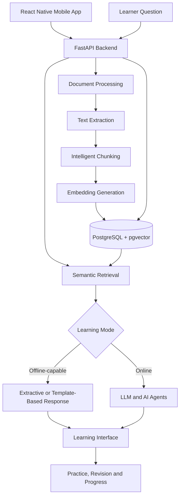

# Questify-easy-learn
Offline-first AI learning platform with RAG, semantic search, pgvector, and a roadmap toward agentic AI and adaptive learning.

### Learn Smarter. Practice Better. Grow Beyond the Classroom.

Questify – Easy Learn is an AI-assisted, adaptive, and gamified learning platform designed to make education more accessible, personalized, and effective. It aims to help students transform their study materials into an interactive learning experience through document-based learning, intelligent retrieval, practice questions, revision tools, and AI-powered tutoring.

Built around an **offline-first foundation and an online AI expansion**, Questify aims to combine accessible learning with the flexibility of modern generative AI.

> **Project status:** Evolving project. Features described in the roadmap are planned capabilities and should not be considered implemented unless explicitly completed.

---

## 📌 Table of Contents

- [The Problem](#-the-problem)
- [Our Vision](#-our-vision)
- [Core Concept](#-core-concept)
- [Key Features](#-key-features)
- [How Questify Works](#-how-questify-works)
- [System Architecture](#-system-architecture)
- [Technology Stack](#-technology-stack)
- [Offline Learning vs Online AI](#-offline-learning-vs-online-ai)
- [Example User Journey](#-example-user-journey)
- [Development Roadmap](#-development-roadmap)
- [Technical Challenges](#-technical-challenges)
- [Privacy and Security](#-privacy-and-security)
- [Future Scope](#-future-scope)
- [Contributing](#-contributing)
- [License](#-license)
- [Author](#-author)

---

## 🎯 The Problem

Students often depend on scattered PDFs, lengthy textbooks, static notes, generic quizzes, and multiple applications to study effectively.

Traditional learning tools frequently lack:

- A simple way to interact with personal study materials.
- Personalized practice based on individual learning needs.
- Reliable access when internet connectivity is limited.
- An integrated workflow for learning, practice, revision, and exam preparation.
- Meaningful progress tracking that helps learners identify weak topics.

Cloud-based AI tools can improve the learning experience, but their dependence on internet connectivity and external AI services can create accessibility, cost, and privacy concerns.

Questify aims to address these challenges through a modular learning platform that combines document-based retrieval, offline-capable study tools, and optional online AI assistance.

## 💡 Our Vision

The long-term vision is to build an intelligent learning companion that adapts to the learner rather than providing the same learning experience to everyone.

Questify is intended to help learners:

- Understand concepts using their own study materials.
- Practice questions relevant to their syllabus.
- Identify knowledge gaps and revisit difficult topics.
- Prepare for examinations through structured revision.
- Continue learning when internet connectivity is unavailable.
- Progress from passive reading to active, personalized learning.

The goal is not simply to build another chatbot or quiz application, but to create an integrated learning environment.

---

## 🧠 Core Concept

Questify follows a two-phase development approach.

### Phase 1: Offline-First, Document-Based Learning

The first phase focuses on enabling learners to study from their own materials without depending on a cloud-based large language model (LLM).

The intended workflow is:

**Upload study material → Extract text → Create meaningful chunks → Generate embeddings → Retrieve relevant content → Display a grounded response**

Planned capabilities include:

- Importing and organizing study materials, especially PDFs.
- Extracting text and preserving useful document structure.
- Splitting content into meaningful sections and chunks.
- Generating embeddings using a locally available embedding model.
- Searching relevant passages using vector similarity.
- Returning relevant information from the uploaded material.
- Making stored practice questions, flashcards, and revision resources available offline where supported.

A key design principle is that learning resources should remain useful even when cloud AI services are unavailable.

**Technical distinction:** Retrieval-Augmented Generation (RAG) retrieval and embeddings do not independently generate natural-language answers. In a no-LLM offline mode, Questify would use retrieved passages, extractive responses, or template-based synthesis. Fully offline operation requires all essential models, dependencies, and data to be available locally.

### Phase 2: Online Generative and Agentic AI

The second phase aims to introduce LLM-powered assistance and specialized AI agents.

Potential capabilities include:

- Explanations of difficult concepts.
- Interactive tutoring and follow-up questions.
- Automatic quiz and practice-question generation.
- Exam preparation tailored to a syllabus or study material.
- Summaries, revision notes, and flashcards.
- Personalized study recommendations.
- Specialized agents for tutoring, revision, quizzes, and exam preparation.

This phase builds on the document-processing and retrieval foundation established in Phase 1.

---

## ✨ Key Features

The following describes the intended product direction, not a claim that every feature is currently implemented.

| Feature                 | Purpose                                                                         |
| ----------------------- | ------------------------------------------------------------------------------- |
| Document-Based Learning | Learn directly from personal study materials.                                   |
| Semantic Search         | Retrieve passages relevant to a learner's question.                             |
| Offline-Capable Study   | Access locally stored learning resources without an active internet connection. |
| Practice Questions      | Reinforce concepts through questions derived from study materials.              |
| Flashcards and Revision | Support recall and repeated practice.                                           |
| AI Tutor                | Provide interactive explanations using online generative AI.                    |
| Exam Preparation        | Organize practice and revision around subjects and syllabi.                     |
| Gamification            | Encourage consistency through goals, streaks, XP, and achievements.             |
| Adaptive Learning       | Eventually personalize practice based on learner performance.                   |
| Learning Progress       | Help learners understand their progress and areas for improvement.              |

---

## ⚙️ How Questify Works

### 1. Document Ingestion

The learner provides study material, such as a PDF. A document-processing pipeline extracts its text and, where possible, useful structural information such as headings, sections, and page numbers.

### 2. Intelligent Chunking

The extracted content is divided into meaningful chunks.

Instead of relying only on arbitrary character limits, the intended approach is to preserve topic boundaries and contextual relationships wherever possible. This helps reduce fragmented passages and improves retrieval quality.

### 3. Embedding Generation

An embedding model converts text chunks into numerical representations that capture semantic relationships.

For genuine offline support, the embedding model must be available locally. Cloud-based embedding services would require connectivity.

### 4. Vector Storage and Retrieval

Embeddings and associated metadata can be stored in PostgreSQL with pgvector.

When a learner submits a question, the system can retrieve relevant chunks using vector similarity and, where appropriate, rerank the candidates to improve relevance.

### 5. Response Generation

The response strategy depends on the selected learning mode:

- **Offline mode:** Display retrieved passages or produce extractive and template-based responses without a cloud LLM.
- **Online mode:** Use an LLM to synthesize a more conversational answer grounded in retrieved material, where applicable.

### 6. Practice and Revision

Retrieved document content can support the creation of practice questions, flashcards, summaries, and revision resources. For offline use, these resources can be generated in advance and stored locally.

### 7. Future Personalization

In a later phase, learning activity and assessment results could be used to estimate topic mastery, identify weaknesses, and recommend what to study next.

---

## 🏗️ System Architecture

The intended architecture separates the mobile interface, backend services, document processing, data storage, and online AI capabilities.

**Architecture note:** This diagram represents the intended logical design. It does not establish that every component is currently implemented or that the mobile application can operate without the backend. A truly offline-capable mobile experience also requires local persistence, local model availability where needed, and suitable offline application logic.

### Architectural Principles

- **Modularity:** Keep document processing, retrieval, learning features, and AI services logically separated.
- **Grounded responses:** Prefer answers supported by the learner's study material when appropriate.
- **Offline awareness:** Identify which operations can run locally and which require connectivity.
- **Extensibility:** Allow future learning agents and personalization features without redesigning the entire system.
- **Maintainability:** Keep backend APIs, database access, and mobile presentation concerns separated.

---

## 🛠️ Technology Stack

The following is the intended technology stack. Actual implementation status may vary.

### Mobile Application

- **React Native** — Cross-platform mobile development.
- **Expo** — Application development and tooling.
- **TypeScript** — Type-safe application code.
- **Expo Router** — File-based navigation.

### Backend

- **Python** — Backend and AI-related development.
- **FastAPI** — API framework.
- **Pydantic** — Request validation and data schemas.
- **SQLAlchemy** — Database access and ORM.
- **Alembic** — Database schema migrations.

### Database and Retrieval

- **PostgreSQL** — Relational data storage.
- **pgvector** — Vector storage and similarity search.
- **Vector embeddings** — Semantic representation of document content.

### AI and Document Processing

- PDF text extraction tools.
- Intelligent document chunking.
- Local embedding models for offline-capable retrieval.
- Optional reranking models for retrieval refinement.
- LLM APIs for online generative features.
- Agent orchestration frameworks for future multi-agent workflows.

Specific model providers and AI frameworks should be documented as dependencies only when they are actually selected and used.

---

## 🌐 Offline Learning vs Online AI

| Capability          | Offline-First Mode                                                             | Online AI Mode                                                 |
| ------------------- | ------------------------------------------------------------------------------ | -------------------------------------------------------------- |
| Internet connection | Not required for supported local workflows after setup and content preparation | Required for cloud services                                    |
| Study material      | Locally available documents and stored content                                 | Local content and, where configured, additional online sources |
| Retrieval           | Local search and retrieval components                                          | Retrieval can be combined with online AI                       |
| Answer style        | Retrieved passages, extraction, or templates                                   | LLM-generated conversational explanations                      |
| Practice            | Previously generated and stored questions                                      | Potential dynamic question generation                          |
| AI agents           | Not dependent on cloud agents                                                  | Specialized LLM-powered agents                                 |
| Availability        | Depends on local data, models, and implementation                              | Depends on connectivity and external services                  |

Offline and online capabilities may overlap. The exact division depends on which models and services are implemented locally.

---

## 📚 Example User Journey

Consider a student preparing for a database management systems examination.

1. The student imports a DBMS PDF.
2. Questify extracts the document's content and organizes it into meaningful sections.
3. The processing pipeline prepares searchable representations of the material.
4. The student asks about normalization or indexing.
5. Questify retrieves relevant passages from the uploaded material.
6. In offline mode, the student reviews the retrieved explanation and source content.
7. In online mode, an AI tutor could provide a more detailed explanation, examples, and follow-up questions.
8. The student practices questions and revisits difficult topics.
9. In a future adaptive-learning version, performance data could inform a personalized revision plan.

This journey illustrates the intended experience; individual steps depend on implementation.

---

## 🗺️ Development Roadmap

The roadmap is organized around progressive development rather than attempting to build every advanced feature at once.

### Phase 1 — Document-Based Learning Foundation

- [ ] Reliable PDF text extraction.
- [ ] Structure-aware chunking.
- [ ] Embedding generation and semantic retrieval.
- [ ] Vector storage and document metadata.
- [ ] Retrieval-based answers with source references.
- [ ] Local availability of previously prepared study resources.
- [ ] Material-derived practice questions and flashcards.
- [ ] Tests for document processing and retrieval quality.

### Phase 2 — Generative AI and Learning Agents

- [ ] Integrate an online LLM service.
- [ ] Implement a grounded AI tutor.
- [ ] Add dynamic quiz and question generation.
- [ ] Build exam-preparation and revision workflows.
- [ ] Introduce specialized learning agents.
- [ ] Evaluate response relevance and factual grounding.

### Phase 3 — Personalization and Adaptive Learning

- [ ] Track topic-level learning progress.
- [ ] Estimate mastery from practice performance.
- [ ] Recommend topics for revision.
- [ ] Introduce personalized difficulty and learning paths.
- [ ] Add gamification and learning goals.

### Phase 4 — Advanced Learning Ecosystem

- [ ] Explore knowledge graphs for relationships between concepts.
- [ ] Add educator-facing progress insights.
- [ ] Improve offline synchronization.
- [ ] Explore multimodal learning.
- [ ] Evaluate local AI inference for suitable devices and workloads.

*Roadmap items are proposed development goals, not promises of delivery or descriptions of existing functionality.*

---

## 🔬 Technical Challenges

Questify involves several interesting engineering challenges:

### Retrieval Quality

Poor chunk boundaries, incomplete text extraction, and irrelevant search results can reduce answer quality. Evaluation should consider retrieval relevance, source-page accuracy, and whether responses are supported by retrieved content.

### Offline Constraints

Running models locally introduces constraints involving device memory, storage, model size, inference speed, and compatibility. Offline functionality must be designed and tested explicitly.

### Grounded AI Responses

Online LLMs may produce unsupported information even when relevant documents are retrieved. The system should distinguish source-supported answers from uncertain or missing information.

### Performance and Scalability

Document ingestion, embedding generation, vector retrieval, and reranking can be computationally expensive. Efficient indexing, caching, batching, and careful model selection can improve responsiveness.

### Learning Personalization

Personalization requires meaningful learning signals and evaluation. Recommendations should eventually be assessed on whether they improve learning outcomes rather than merely increasing application engagement.

---

## 🔐 Privacy and Security

Educational documents may contain personal, academic, or otherwise sensitive information. Privacy should therefore be a core design consideration.

The intended approach includes:

- Keeping API keys and database credentials outside source code.
- Using environment variables for sensitive configuration.
- Excluding `.env` files, local databases, and private user data from version control.
- Restricting database access and validating incoming requests.
- Configuring CORS appropriately for development and production.
- Explaining when uploaded material is processed locally or sent to an external service.
- Avoiding unnecessary retention of documents and learning activity.
- Providing appropriate authentication and authorization for private learning data.

Offline processing can reduce dependence on external services, but it does not automatically guarantee security or privacy.

---

## 🔮 Future Scope

Questify could eventually evolve into a personalized learning ecosystem with:

- Knowledge graphs connecting related concepts across subjects.
- Adaptive revision schedules based on retention and performance.
- Multimodal learning using text, images, and other supported formats.
- User-configurable AI learning agents.
- Teacher dashboards and learning analytics.
- Better synchronization between offline and online sessions.
- Local inference for selected AI workloads.
- Integration with structured syllabi and examination patterns.

These extensions would be prioritized according to technical feasibility, educational value, and user feedback.

---

## 🤝 Contributing

Contributions can help improve Questify's usability, reliability, and educational value.

Potential areas include:

- Document extraction and processing.
- Retrieval quality and evaluation.
- Mobile UI and accessibility.
- Backend API design.
- Offline-first functionality.
- Testing, documentation, and bug fixes.

A typical contribution workflow is:

1. Fork the repository.
2. Create a feature branch.
3. Make focused changes.
4. Add or update relevant tests.
5. Document the changes.
6. Open a pull request describing the motivation and implementation.

Detailed development and setup instructions should be added once the repository structure and implementation are finalized.

---

## 👩‍💻 Author

**Vishakha Shishodia**

B.Tech in Computer Science and Engineering

Project: Questify – Easy Learn
- LinkedIn:(https://www.linkedin.com/in/vishakha-shishodia-2191613a8/)

---

### Final Note

Questify's central idea is simple: **make learning more accessible, more interactive, and more personalized by combining document-based retrieval, offline-capable study tools, and online AI assistance.**

The long-term ambition is to help learners move beyond simply consuming information toward understanding concepts, practicing effectively, and learning at their own pace.
